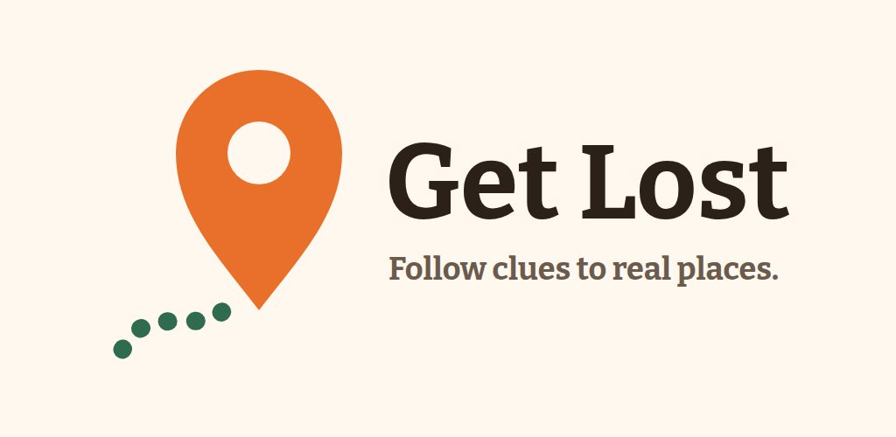

# Get Lost

> **Work in progress.** Get Lost is an early proof of concept, tested with friends and family. Expect rough edges, missing features and changes between versions.

Get Lost is a scavenger hunt played in the real world. Follow a clue to a real place, prove you got there, and the next clue unlocks.

This repository only hosts the Android app for download. The app's source code is not public.

## How it works

- **Creators** build a **Quest** on the website, [getlost.sherpas.party](https://getlost.sherpas.party). A Quest is a chain of **Tasks**, each with a clue. A Task can ask the player to:
  - reach a place (checked with the phone's location);
  - scan a QR code the creator printed and hid;
  - type an answer, a number, or pick from choices.
- Each Task's location can be **hidden** (the clue is all you get), given as a **hot/cold** hint, or **shown** on a map.
- The website prints a poster with a QR code to join, plus cards for the QR Tasks.
- **Players** join with a 6-character **Join Code** or by scanning the poster, then work through the Tasks in order. The app records how long each Task took, and finished Quests stay in **My Quests**.

## What it's for

- Scavenger hunts for friends and family: around the neighborhood, a park, a campus or a downtown.
- Birthday parties and group outings. For younger kids, play in teams on a parent's phone.
- Later: Quests that bring players to local businesses, and live events and races. These are ideas, not features yet.

## Install (Android)

There is no iPhone version yet, and the app isn't on Google Play yet.

1. On your Android phone, open the [latest release](../../releases/latest) and download the `.apk` file.
2. Open the downloaded file. Android asks you to allow installs from your browser or file manager; allow it once.
3. Google Play Protect may warn that the app is from an unknown developer. Choose to install anyway. You can reinstall or remove the app at any time.
4. Open **Get Lost** and sign in with your email. You get a 6-digit code by email; check your spam folder if it doesn't arrive. Use the same email as on the website to keep one account.

**Updates:**
- Small fixes arrive automatically: open the app, close it, and open it again.
- Bigger updates need a new `.apk` from the releases page. You can also let [Obtainium](https://obtainium.imranr.dev/) watch this repository and install new releases for you.

## Privacy

Your location is checked only when you submit a Task or ask for a hint, never in the background. You can delete your account in the app (Profile → Delete account) or on the website.

Full policy: [getlost.sherpas.party/privacy](https://getlost.sherpas.party/privacy)

## Feedback and contributing

Get Lost is a personal project. To report a problem, share ideas, or help out, email **Samuel.johnson.wi@gmail.com**.

© Samuel Johnson. All rights reserved. The app is free to install and use for testing.
